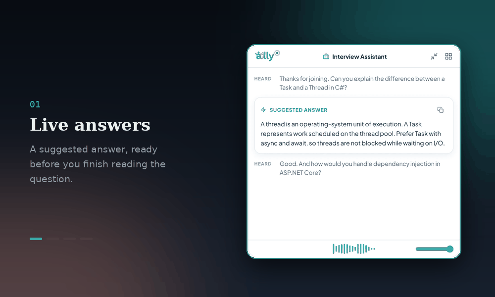
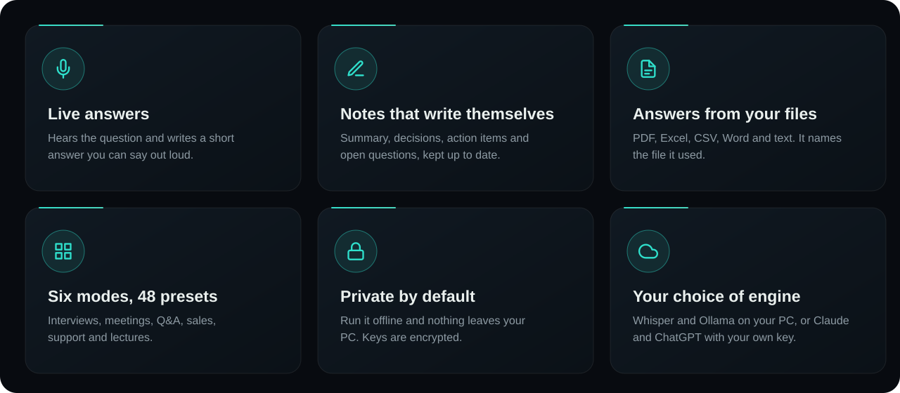
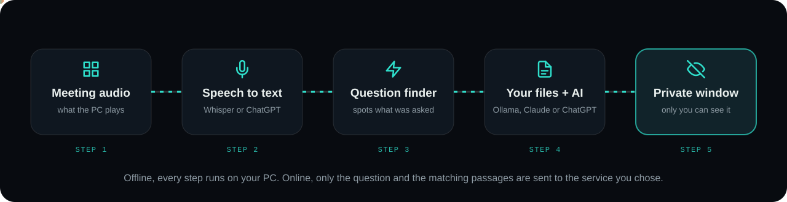
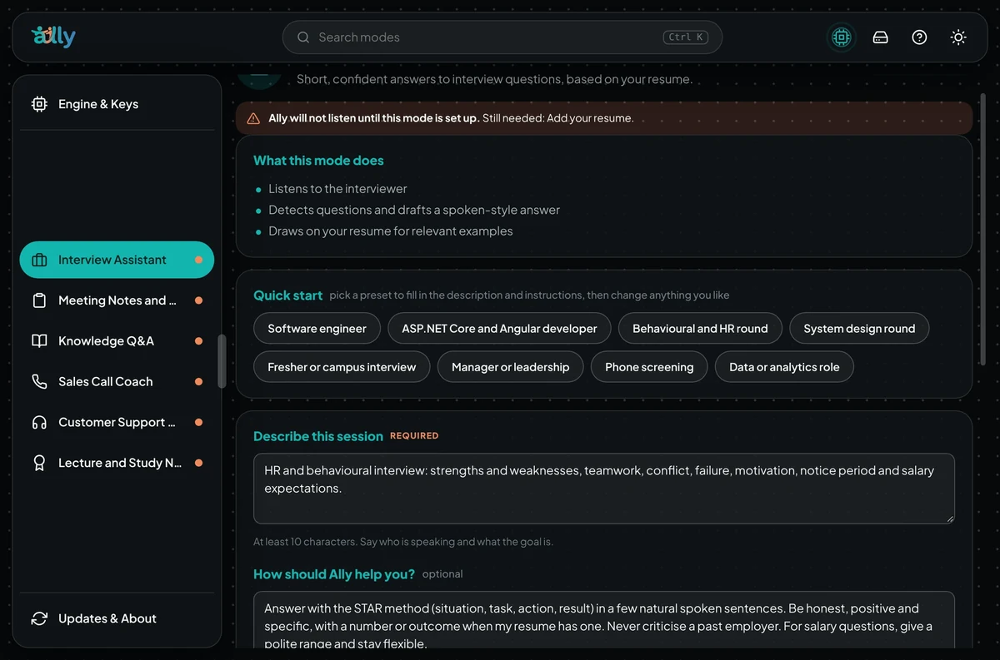
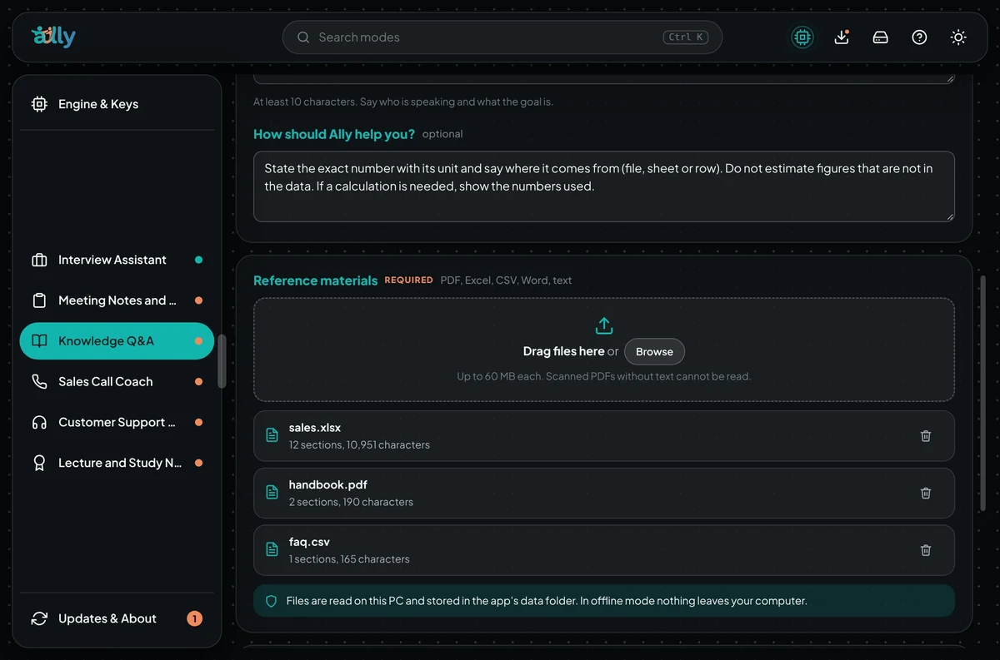

  
  
  
  
  

  <a href="#-what-it-does">What it does</a> ·
  <a href="#-how-it-works">How it works</a> ·
  <a href="#-invisible-to-screen-sharing">Invisible</a> ·
  <a href="#-modes">Modes</a> ·
  <a href="#-offline-or-online">Offline or online</a> ·
  <a href="#-install">Install</a> ·
  <a href="#-hotkeys">Hotkeys</a> ·
  <a href="#-faq">FAQ</a>

 

> [!NOTE]
> **Ally** is a personal AI companion for Windows 10 and 11. It listens to your meetings, interviews and calls, suggests short answers to the questions it hears, keeps rolling notes, and can answer from your own PDFs, spreadsheets and documents. Its windows are left out of screen sharing, recordings and screenshots.

 

## ✨ What it does

 

<b>🎙️ Live answers</b>: short enough to say out loud

 

Ally transcribes the call as it happens. When someone asks you something, a suggested answer is already waiting beside the call. Answers are written the way people talk, so you can say them as they are.

<b>📝 Notes that write themselves</b>

 

Summary, decisions, action items and open questions, kept up to date while people talk. Pick a template (general, stand-up, one-to-one, client call or brainstorm), ask for a final summary when the call ends, then copy it or save a Markdown file. Every session is saved on your PC.

<b>📚 Answers from your own documents</b>

 

Drop in PDF, Excel, CSV, Word and text files (up to 60 MB each). For each question Ally finds the best-matching passages and tells you which file they came from. Because only the matching passages are used, large files work even with small offline models. Files are read on your PC.

<b>🧩 Six modes and 48 presets</b>

 

Every mode comes with ready-made presets. Pick one, check the text, add your files and save. A step-by-step guide shows you around the first time (easy to skip), and Ally waits until a mode is completely set up before it listens.

<b>🔔 Updates that stay out of your meeting</b>

 

Ally checks for a newer release when it starts and every 6 hours (you can switch this off). A new version is announced only inside Ally's own windows, never as a Windows pop-up, because a pop-up could show up in a screen share. Your settings, keys, modes, files and models are kept when you update.

## 🧠 How it works

1. **Listen.** Ally captures what your PC plays, so it hears the other people on the call.
2. **Transcribe.** Speech becomes text with Whisper on your PC, or with ChatGPT's speech recognition if you choose that.
3. **Spot the question.** A question finder decides when someone has asked something that needs an answer.
4. **Think.** Ally searches your files for the matching passages, then asks the AI you picked: Ollama on your PC, Claude or ChatGPT.
5. **Show it privately.** The answer appears in a floating window that screen sharing does not capture.

## 👻 Invisible to screen sharing

Ally's windows use Windows' own capture exclusion, so screen sharing, recordings and screenshots get the call and nothing else. Your window stays on your screen alone.

> [!WARNING]
> Some remote-desktop tools behave differently with protected windows. **Try Ally before an important call**, and use it only where recording, transcription and AI assistance are allowed.

## 🎭 Modes

| Mode | What it does |
| --- | --- |
| 🎤 **Interview Assistant** | Short, spoken-style answers to interview questions, using your resume. |
| 📝 **Meeting Notes and Summariser** | Transcribes everything and keeps live notes: key points, decisions and action items. Final summary on demand, copy or save as Markdown. |
| 📚 **Knowledge Q&A** | Answers from your own documents and cites the file it used. |
| 📞 **Sales Call Coach** | Next-line suggestions and objection handling, optionally from your product material. |
| 🎧 **Customer Support** | Suggested replies and troubleshooting steps from your knowledge base. |
| 🎓 **Lecture and Study Notes** | Structured study notes with definitions and review questions. |

For every mode you can write a **session description** and **instructions** ("how should the AI help me"), and add **reference materials** by dragging files onto the Control Center or the floating window.

<table>
  <tr>
    <td width="50%"></td>
    <td width="50%"></td>
  </tr>
  <tr>
    <td align="center">Presets and instructions</td>
    <td align="center">Reference materials</td>
  </tr>
</table>

## 🔒 Offline or online

You choose where Ally runs, and you can change it any time in **Settings**.

| | 🏠 Offline | ☁️ Online | 🎚️ Custom |
| --- | --- | --- | --- |
| **Speech to text** | Whisper on your PC | ChatGPT speech recognition | Either one |
| **Answers** | Ollama models on your PC | Claude or ChatGPT | Either one |
| **Account or key** | None | Your own API key | Only for the online parts |
| **What leaves your PC** | **Nothing** | Audio and/or each question plus the matching passages | Only what you switch online |
| **Download** | About 245 MB plus the models you choose | From about 180 MB | Sizes shown before anything downloads |

- API keys are stored **encrypted on your PC** (Windows DPAPI).
- The installer detects your RAM, CPU and graphics card, then marks one model *Recommended* and one *Best for your PC*.
- Every download is listed **with its size** first, and Ally checks free disk space before it starts.

## 🚀 Install

<table>
<tr>
<td width="64" align="center"><h3>1</h3></td>
<td><b>Download</b> <code>Ally-Setup.exe</code> from the <a href="https://github.com/krishanmurariji/ally-releases/releases/latest">latest release</a>. It is a small web installer (under 200 KB), like the ones browsers use.</td>
</tr>
<tr>
<td align="center"><h3>2</h3></td>
<td><b>Choose</b> <i>Completely offline</i>, <i>Completely online</i> or <i>Custom</i>, and the install folder. No administrator permission is needed.</td>
</tr>
<tr>
<td align="center"><h3>3</h3></td>
<td><b>Pick the models.</b> The installer recommends what fits your PC and lists every download with its size.</td>
</tr>
<tr>
<td align="center"><h3>4</h3></td>
<td><b>Start Ally.</b> It opens with your choices already filled in and finishes any model downloads with progress bars.</td>
</tr>
</table>

> [!TIP]
> **Prefer one file, with no internet during install?** Get **Ally-Full-Setup-x.y.z.exe** from the same release page. It holds the application and the engine. Ollama and the models are still downloaded by the app.

> [!IMPORTANT]
> Windows may show a **SmartScreen** notice the first time, because the installer is not code-signed yet. Choose **More info**, then **Run anyway**.

| You pick | You download |
| --- | --- |
| Online with ChatGPT | The application and a small online engine. Nothing else. |
| Online with Claude | The application, an engine with offline speech and the speech model (Claude has no speech API). |
| Offline, or custom with local models | The application and the full engine, then Ollama, the AI model and the speech model. |

**Updating.** In the Control Center, open *Updates*. For installs made with the web installer, *Download and install* fetches the new installer, verifies its SHA-256 checksum and runs it in quick update mode. Only the app and engine are downloaded.

**Uninstalling.** Use the Control Center (*Storage and uninstall*) to choose what to remove, or use Windows Settings, then Apps. The uninstaller asks whether to also delete your settings, keys, notes and models.

## 🔑 Hotkeys

| Shortcut | Action |
| --- | --- |
| <kbd>Ctrl</kbd> + <kbd>Shift</kbd> + <kbd>Space</kbd> | Show or hide the floating window |
| <kbd>Ctrl</kbd> + <kbd>Shift</kbd> + <kbd>C</kbd> | Clear the conversation |
| <kbd>Ctrl</kbd> + <kbd>Shift</kbd> + <kbd>M</kbd> | Open the Control Center (modes, materials, uninstall) |
| <kbd>Ctrl</kbd> + <kbd>Shift</kbd> + <kbd>S</kbd> | Open the setup wizard again |
| <kbd>Ctrl</kbd> + <kbd>Shift</kbd> + <kbd>Q</kbd> | Quit |

## 🔊 Hearing the other people

Ally listens to what your PC plays. If you only hear your own voice in the transcript, turn on **Stereo Mix**: *Control Panel → Sound → Recording → right-click → Show Disabled Devices → Enable Stereo Mix*.

## 🛠️ Troubleshooting

<b>Ally is running but I see no window</b>

 

This is almost always the graphics driver (older Intel chips, virtual machines). Ally shows its window anyway, switches to compatibility (software) rendering by itself if the graphics process crashes twice, and offers a **Restart in compatibility mode** button if nothing is visible after 12 seconds. You can also start it by hand with `Ally.exe --safe-graphics`.

<b>A setup step failed</b>

 

The page shows the error with **Retry**, **Skip and finish anyway**, **Open logs** and **Copy diagnostics**. Copy the diagnostics into an [issue](https://github.com/krishanmurariji/ally-releases/issues) and it will help a lot.

<b>Where are the logs and my data?</b>

 

Everything is in `%APPDATA%\Ally`: `logs` (`app.log`, `backend.log`, `backend-crash.log`), `sessions` (autosaved notes and transcripts), and your settings and materials. *Settings → Open logs* opens the folder.

<b>The answers are slow</b>

 

Offline models depend on your PC. A smaller model answers faster, and online mode (Claude or ChatGPT) is usually the quickest. You can change the engine any time in Settings.

## ❓ FAQ

<b>Which AI service do I need?</b>

 

None, if you run offline: speech recognition and the AI run on your PC. If you choose online mode, you use your own Claude or ChatGPT API key, and that service bills your key.

<b>Can other people see Ally during screen sharing?</b>

 

Ally's windows are excluded from screen sharing, recordings and screenshots on Windows 10 version 2004 and newer. Some remote-desktop tools behave differently, so try it before an important call.

<b>Does it send my files or audio anywhere?</b>

 

Not when you run offline. In online mode, the audio (if you chose cloud speech recognition) and each question with its matching passages go to the service you picked, using your own key. The update check reads one small file from this repository and sends nothing about you.

<b>What do I need to run it?</b>

 

Windows 10 version 2004 or newer, 64-bit. For offline mode, enough RAM and disk space for the models you pick (the installer recommends models that fit). For online mode, your own Anthropic (Claude) or OpenAI (ChatGPT) API key.

<b>Is it safe to run an unsigned installer?</b>

 

The installer is not code-signed yet, which is why Windows shows a SmartScreen notice. Every release lists its files here, and in-app updates verify a SHA-256 checksum before they run.

**Questions or problems?** [Open an issue](https://github.com/krishanmurariji/ally-releases/issues).

Ally is independent software. Claude and ChatGPT are trademarks of their owners and are used with your own API key. Please use Ally only where recording, transcription and AI assistance are allowed.

 

This repository hosts the public releases of Ally. Icons by <a href="https://feathericons.com">Feather</a> (MIT).

